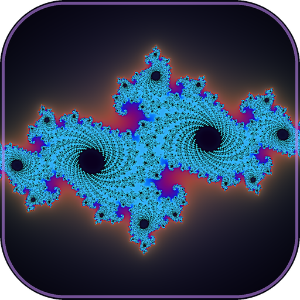

# Morphwave



A real-time fractal music visualiser for Windows 11. It listens to whatever your
PC is playing and drives GPU-rendered fractals with it: endless zooms and 3D
fly-through tunnels whose speed, colour and shape follow the music.
Run it fullscreen or as a live desktop wallpaper behind your icons.

Everything is computed per pixel on the GPU, every frame, at full resolution.
There are no images or videos, so detail stays sharp.

## Start it

| File | What it does |
|---|---|
| `Morphwave.bat` | Fullscreen visualiser |
| `Morphwave Wallpaper.bat` | Live wallpaper behind your desktop icons |
| `Morphwave Settings.bat` | Settings only, without starting the visualiser |
| `Morphwave (with console).bat` | Fullscreen with a console and the info overlay, for troubleshooting |

## Shortcuts

These work anywhere, even while it is the wallpaper.

| Keys | Action |
|---|---|
| Ctrl+Alt+S | Settings |
| Ctrl+Alt+→ / ← | Next / previous theme |
| Ctrl+Alt+Space | Next scene |
| Ctrl+Alt+H | Info overlay (fps, BPM, vibe, speed) |
| Ctrl+Alt+W | Switch fullscreen ↔ wallpaper |
| Ctrl+Alt+Q | Quit |

In the visualiser window the same keys work without Ctrl+Alt, and Esc also quits.
A slim button dock pops up along the bottom whenever you press a key or move the
mouse, then dissolves after a few seconds of leaving it alone. Its buttons are
clickable (right-click Theme to go back a theme). As wallpaper, move the mouse
over the bottom of the bare desktop to bring the dock up and click it there.

## Scenes

| Scene | Motion |
|---|---|
| Julia set (2D) | Falls forever into the set's own spiral |
| Mandelbrot dive (2D) | Dives about 5000x into famous spots, one after another |
| Apollonian lace (2D) | Falls into a junction of circles |
| Menger tunnel (3D) | Flies through an endless, twisting stone sponge |
| Sphere-lace tunnel (3D) | Flies through bubbles packed inside bubbles |
| Kleinian caverns (3D) | Flies through organic limit-set caverns |

## Default: the Infinite Journey

The default theme flies you through 36 different 3D fractals without ever fading.
Every 48 beats the next fractal is planted a little way down the tunnel, and the
geometry itself morphs from one into the other as you fly into it.

| Theme | What it is |
|---|---|
| Infinite Journey | 36 fractals, seamless morphs (default) |
| Menger Odyssey | Only the 12 Menger-sponge fractals |
| Net of Being | An endless hall of arches whose walls are made of watching eyes |
| Cosmic Ocean | Waves below, rippling sky-rings above, floating glowing shards |
| Unimaginable Horrors | The eye forest, a flesh-coloured Net of Being and organic fractals |

## How the music drives it

- **Speed:** BPM, how busy the beats are, the long-term energy, and the bass.
- **Colour comes from the music:** quiet passages are muted, loud ones vivid; in silence
  everything slows almost to a stop and fades to near greyscale.
- **Waves through the surfaces:** each slice of tunnel depth is tied to a frequency band,
  so ripples run through the fractal walls themselves, and the waveform wraps around them.
- **Beats:** a soft shockwave or light wave (no flashing); every N beats the scene changes.
- **Spectrum:** each colour band of the fractal is tied to a frequency band.
- **The scene itself bends:** in the 2D scenes the waveform ripples the whole plane,
  mids swirl the centre, bass swells it and each beat sends a shockwave outwards.
  In the tunnels, bass swells the walls, the waveform ripples them, mids corkscrew
  the tunnel, spectrum bands light up along the walls and each beat fires a light
  pulse down the tunnel. Strength: Settings → Visuals → "Music bends the scene".
- **Waveform ring:** optional and off by default (Settings → Display).
- **Vibe:** long-term energy and brightness blend the theme from its calm palette to its intense one.
  Energetic music also favours the 3D tunnels. You can fix the vibe in Settings.

## Themes

A theme is a `.json` file in `themes/`: which scenes it uses, how often it changes
scene, two colour palettes and effect strengths. Edit them live in
Settings → Visuals, then press **Save theme**.

## Code

| File | Role |
|---|---|
| [audio.py](morphwave/audio.py) | Loopback capture, FFT, beats, BPM, waveform, long-term vibe |
| [shaders.py](morphwave/shaders.py) | All fractals and effects (GLSL) |
| [renderer.py](morphwave/renderer.py) | Window, frame loop, scene changes, speed, auto quality |
| [settings_ui.py](morphwave/settings_ui.py) | Settings window |
| [winutil.py](morphwave/winutil.py) | Wallpaper embedding, global hotkeys |

## Run from source

```
py -3.14 -m venv .venv
.venv\Scripts\python -m pip install -r requirements.txt
.venv\Scripts\python -m morphwave
```

## Build Morphwave.exe

Run `build_exe.bat`. The program lands in `dist\Morphwave\` (keep `Morphwave.exe` and
`_internal` together). The fractal icon is generated by `tools\make_icon.py`.

Windows 10/11 only (WASAPI loopback, desktop wallpaper embedding, global hotkeys).
